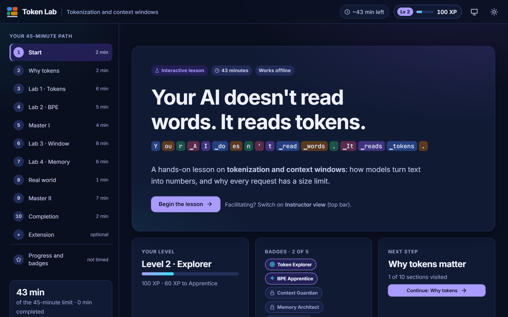
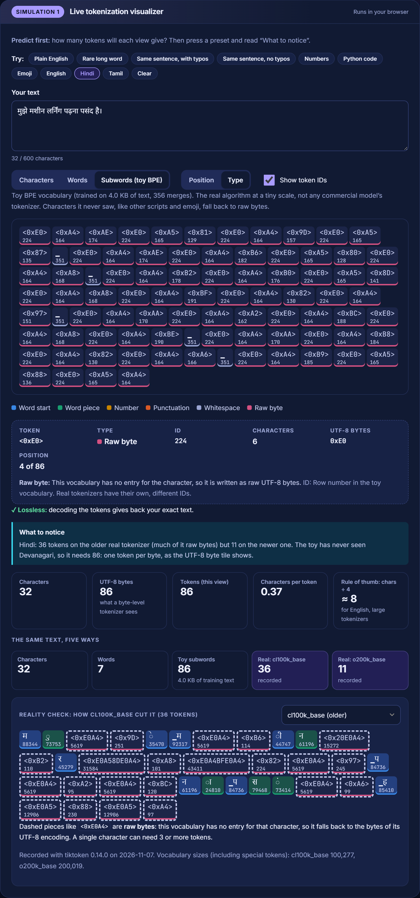
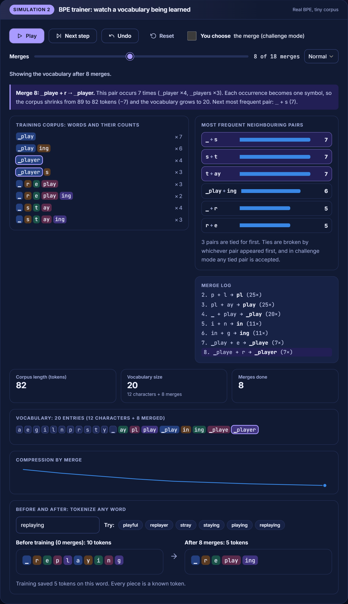
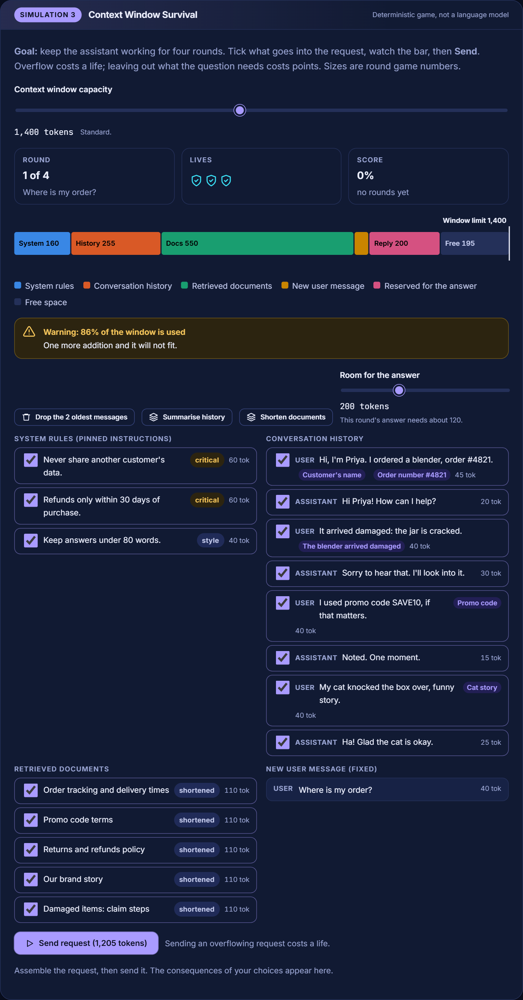
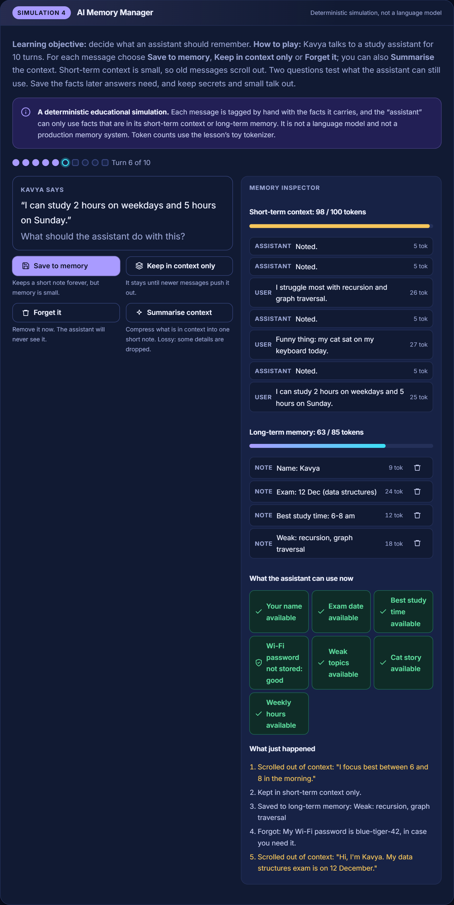
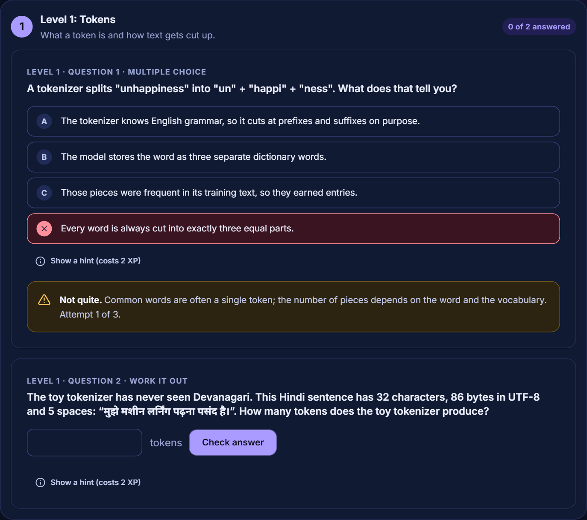
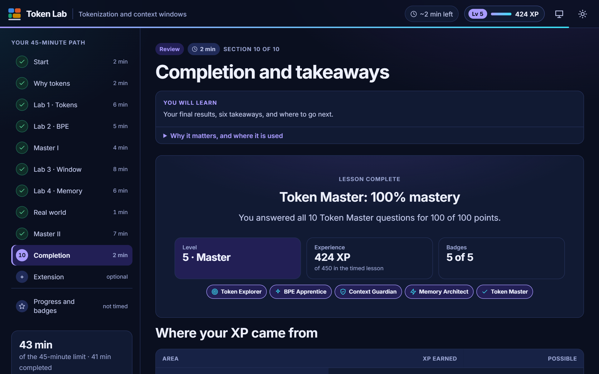
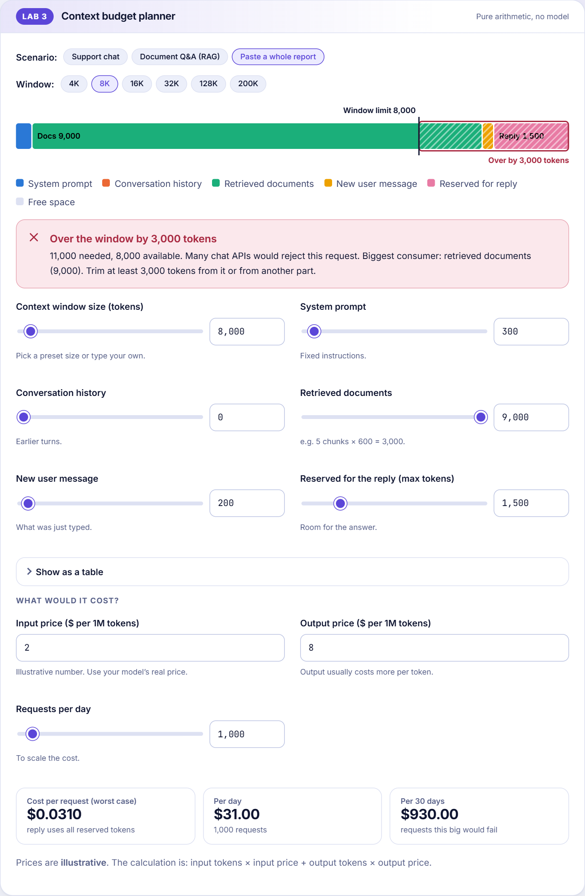
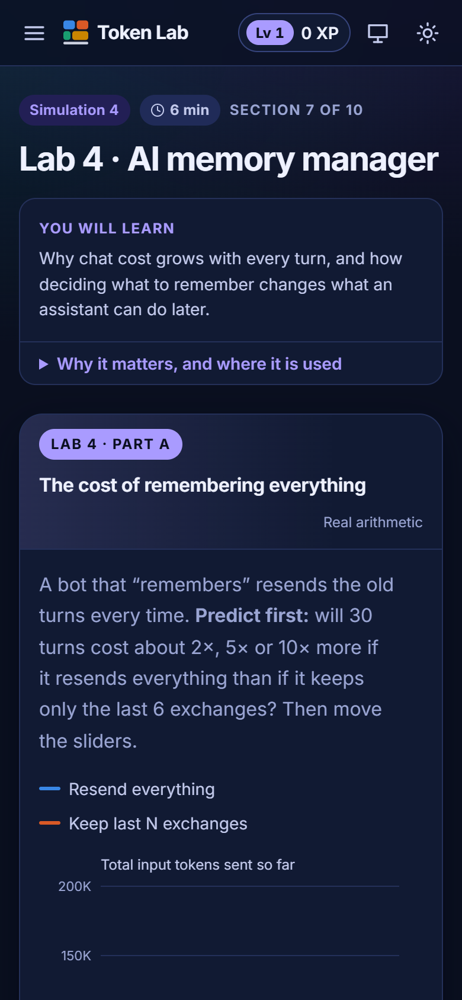

# Token Lab 2.0

**An interactive 43-minute lesson on tokenization and context-window management for large language models, built from five hands-on simulations, with XP, badges and a mastery challenge that reward understanding rather than clicking.**
👉 **Live Interactive Demo:** [https://sayedishan.github.io/token-lab/](https://sayedishan.github.io/token-lab/)
You don't just read about tokens. You tokenize your own text and inspect every token, run the Byte-Pair Encoding algorithm one merge at a time, keep a simulated assistant alive inside its context window, decide what a chatbot should remember (and never store), and finish with a five-level mastery challenge whose practical answers are computed by the same engines the labs use.

> Created by **Sayed Ishan** as the teaching artifact for the *Instructional Designer Intern (AI Courses)* assignment. Topic chosen: **1. Tokenization and Context Window Management**. This work is for hiring evaluation only.

| | |
|---|---|
| <br>**Dashboard:** level, badges and next step; objectives; a real-vs-simplified box | <br>**Simulation 1, Tokenization Visualizer:** a Hindi sentence, token IDs, colour by type and the inspector |
| <br>**Simulation 2, BPE Trainer:** merge log, vocabulary and before/after tokenization | <br>**Simulation 3, Context Window Survival:** assemble each request; overflow costs a life |
| <br>**Simulation 4, AI Memory Manager:** save, keep or forget each message, then answer probes | <br>**Simulation 5, Token Master:** five levels; every option has its own explanation |
| <br>**Completion screen** (unlocked by finishing all five levels; shown with a completed run) | <br>**Light theme** (dark navy is the default) |
| <br>**Phone width:** the layout is tested at 390, 360 and 320 px | |

*Screenshots are real states of the running app. The dashboard and completion screens use progress saved the same way the labs save it.*

---

## What's new in 2.0 (and what was kept)

2.0 **extends** 1.0; it is not a rewrite. The algorithms, the recorded real-tokenizer data, the cost model, the code-challenge sandbox and the offline guarantee are unchanged and still tested.

| | 1.0 | 2.0 |
|---|---|---|
| **Lab 1** | Tokenizer playground | Adds a **token inspector** (type, ID, UTF-8 bytes), colour by token type, an ID toggle, and character/word/token counts |
| **Lab 2** | BPE merge-by-merge | Adds **Play / Pause / Next / Previous / Reset**, a merge-count slider, the vocabulary, **before/after tokenization** and a per-merge explanation. "You choose" mode kept |
| **Lab 3** | Budget planner | Planner kept; adds the **Context Window Survival** game |
| **Lab 4** | Cost chart and four strategies | Adds the **AI Memory Manager**; the strategy comparison is kept as an optional deep dive |
| **Quizzes** | Two 5-question checkpoints | The **Token Master** challenge: 5 levels, 3 question types, hints, scoring, mastery % |
| **Game layer** | none | **XP, 5 levels, 5 badges**, a dashboard, level-by-level unlocking, a completion screen |
| **Look** | Light | **Dark navy default** with purple / cyan / blue accents; light theme kept |
| **Final challenge** | A counted 6-minute section | Now an **optional extension** at the end, outside the 45 minutes (fully working, still tested) |

## Run it (no installation)

**Option A: double-click `index.html`.** It opens in any modern browser. There is no build step, no server, no account, no API key, and nothing is downloaded: fonts and data are bundled, and the lesson makes **zero network requests**.

**Option B: a local server** (only if you prefer `http://localhost`; needs [Node.js](https://nodejs.org) 18+):

```bash
node tools/serve.js        # then open http://localhost:8080
# or: npm start
```

**Option C: host it free on GitHub Pages**: push the repo, then *Settings → Pages → Deploy from branch → `main` / root*. Evaluators get a live link.

---

## What students learn

By the end of the lesson a student can:

1. **Explain** what a token is and why models read tokens rather than characters or words.
2. **Predict** how typos, numbers, code and non-English scripts change the token count.
3. **Run** Byte-Pair Encoding and describe how a vocabulary is learned.
4. **Calculate** whether a request fits a context window.
5. **Decide** what an assistant should remember, and what it must never store.
6. **Apply** it to realistic decisions in two games and a mastery challenge.

**Prerequisites:** having used a chatbot, and basic arithmetic. The optional extension reads a short JavaScript function.

## The 43-minute path

| # | Section | Min | What the student does |
|---|---|---|---|
| 1 | Start | 2 | Reads the objectives and the real-vs-simplified box; makes a prediction |
| 2 | Why tokens matter | 2 | Meets 3 real problems; steps through the 5-stage journey of a sentence |
| 3 | **Simulation 1 · Tokenization Visualizer** | 6 | Tokenizes any text 3 ways, inspects tokens, compares with recorded real tokenizers |
| 4 | **Simulation 2 · BPE Trainer** | 5 | Plays, pauses and steps real BPE, or *chooses* each merge; tokenizes an unseen word |
| 5 | **Simulation 5 · Token Master I** (levels 1-2) | 4 | 4 questions; two are worked out against the engine |
| 6 | **Simulation 3 · Context Window Survival** | 8 | Budget planner, then a four-round game |
| 7 | **Simulation 4 · AI Memory Manager** | 6 | Cost chart, then eight decisions about what to remember and two probe questions |
| 8 | Where this shows up | 1 | Maps six products to the token decisions behind them |
| 9 | **Token Master II** (levels 3-5) | 7 | 6 questions: budgets, memory, realistic scenarios |
| 10 | Completion | 2 | Results, XP by area, six takeaways |
| | **Total** | **43** | |
| + | *Optional extension: fix the bot and write `trimToFit()`* | *not counted* | The 1.0 final challenge, kept intact |

**Read this before trusting "43".** The times come from an explicit model (visible words ÷ 180 wpm, plus feedback text, plus estimated interaction time) rather than a guess, and applying that model honestly to my first 2.0 build showed it was about 47 minutes, so I cut and restructured it (see [docs/INSTRUCTIONAL_DESIGN.md](docs/INSTRUCTIONAL_DESIGN.md)). The model now says **43.4 minutes against the 45-minute limit**, which is a thin margin: it breaks even at about 169 words per minute. **It has not been piloted with real learners.**

It works for **self-paced learning** or **instructor-led teaching**: the *Instructor view* toggle (top bar) reveals talking points, a discussion question and a likely misconception for every section, unlocks every Token Master level and previews the completion screen.

---

## The five simulations

| # | Simulation | What it teaches | What makes it real |
|---|---|---|---|
| 1 | **Tokenization Visualizer** | Subwords vs characters vs words; why typos, numbers, code and scripts cost differently | A real BPE tokenizer runs on any text (up to 600 characters); an inspector shows each token's type, ID and UTF-8 bytes; a panel compares **recorded** output from two real tokenizers |
| 2 | **BPE Trainer** | How a vocabulary is learned by merging the most frequent pair | The real algorithm, deterministic: the same pair counts every time. Play / Pause / Next / Previous / Reset, a 0-18 merge slider, the vocabulary, before/after tokenization of any word, and a per-merge explanation |
| 3 | **Context Window Survival** | What competes for the window, and what must still be in the request | Four rounds. Pick which rules, history and documents to send; overflow costs a life, omitting what the question needs costs points. Deterministic rules, **not a language model** |
| 4 | **AI Memory Manager** | What to save, keep, forget, summarise, and never store | Ten turns (eight decisions, two probes), a capped short-term context and long-term memory, a lossy summarise action, and probe questions. Deterministic, **not a language model** |
| 5 | **Token Master Challenge** | Retrieval practice across all four topics | 5 levels × 2 questions; multiple choice, work-it-out numbers and select-all; hints, scoring, mastery %. Answers to practical questions come from the engines, so they cannot drift from the labs |

### Gamification that is tied to learning

- **XP is earned only by learning activities** (predicting, experimenting, finding the BPE pair yourself, scoring in a simulation, answering). Visiting a page earns nothing, and each activity pays once, so XP cannot be farmed.
- **5 badges** (*Token Explorer, BPE Apprentice, Context Guardian, Memory Architect, Token Master*), each showing its criteria and requiring real evidence.
- **5 levels** (Newcomer → Master). The timed lesson awards up to **450 XP**; the top level starts at 360, so no level depends on optional work.
- **Unlockable content:** Token Master levels open in order; the completion screen opens only when all five are done.

## What is real, and what is simplified

This matters, so the lesson says it on its first page too.

| Real | Simplified on purpose |
|---|---|
| The **BPE algorithm** is implemented from scratch and runs live in the browser | The toy tokenizer learned from only ~4 KB of text I wrote, so its counts **differ from any commercial model's** |
| Context-window and cost **arithmetic** | Prices are **made-up, illustrative** numbers |
| Real tokenizer outputs for `cl100k_base` and `o200k_base`, **recorded with tiktoken 0.14.0** on 2026-11-07 (`tools/record_real_tokens.py`) | The recordings are static: a real vocabulary is 1-2 MB, too big to ship in a page |
| Token Master's practical answers are computed by the labs' engines | **The two games are deterministic rules, not language models**: the assistant can only use facts still inside its window or memory, and token sizes in the survival game are round game numbers |

Nothing is pretending to be a production AI model. No API key is needed or used.

---

## Technology and architecture

**Vanilla HTML + CSS + JavaScript. Zero runtime dependencies.** React was not justified: the lesson is a set of focused widgets, and avoiding a build step is what makes "double-click to run" possible.

- **Classic `<script>` tags, not ES modules**, because browsers block module imports from `file://`.
- **Core logic is separate from the UI**: `js/core/` is plain JavaScript that runs identically in the browser and in Node (that is how it is unit-tested). `js/ui/` and `js/sections/` only render.
- **Data-driven**: sections, minutes and quizzes are data, so the sidebar, the total and the instructor notes are generated from one source of truth, and a test fails if the timed path ever exceeds 45 minutes.
- **No `innerHTML` anywhere.** Student text is always inserted as text nodes, so nothing a student types can execute.
- **Student code (optional extension) runs in a Web Worker** with a timeout, so an infinite loop cannot freeze the page.
- **Self-hosted fonts** (Inter, JetBrains Mono under the SIL OFL) for consistent typography offline.

Read the full explanation, with the reasoning behind each decision, in [docs/ARCHITECTURE.md](docs/ARCHITECTURE.md).

```
token-lab/
├── index.html              Entry point
├── css/                    tokens (design system) · base · components · labs · sims
├── js/
│   ├── core/               bpe · toy · modes · estimate · context · survival · memorymgr ·
│   │                       master · gamification · memory · challenge      (pure logic)
│   ├── data/               lesson · quizzes · corpus · real-tokens (generated)
│   ├── ui/                 dom · store · gamify · components · charts · quiz · code-runner
│   ├── sections/           one file per lesson page; survival-ui · memory-ui · master-ui
│   └── app.js              routing, sidebar, theme, XP chip
├── tests/                  unit (Node) and e2e (headless browser)
├── tools/                  record_real_tokens.py · serve.js
├── docs/                   ARCHITECTURE · INSTRUCTIONAL_DESIGN · TEST_REPORT · images
└── assets/                 fonts (+ licences) and favicon
```

---

## Testing: actual results

Run on 2026-11-07, Windows 11, Node v24.8.0. Every number below comes from a run I executed; the full log summary is in [docs/TEST_REPORT.md](docs/TEST_REPORT.md).

| Suite | Command | Result |
|---|---|---|
| **Unit tests** | `npm test` | **100 / 100 pass** |
| **End-to-end**, real **Chrome 156** opened from `file://` | `node tests/e2e/smoke.e2e.cjs` | **109 / 109 pass** |
| **End-to-end**, **Microsoft Edge 156** (same suite) | `BROWSER_WS=<ws url> node tests/e2e/smoke.e2e.cjs` | **109 / 109 pass** (see the report for a flake found and fixed) |

Edge uses the same Chromium engine as Chrome, so this is a second *browser*, not a second *engine*. **Firefox and Safari were not tested** (Firefox is not installed here).

The unit tests verify the algorithms and the lesson's own claims: BPE round-trips any text losslessly (English, Hindi, Tamil, emoji, code); the survival and memory engines obey their rules; XP is earned once and cannot be farmed; Token Master answers are engine-computed with no guessable position or length pattern; every quoted number matches the recorded data; the timed path totals 43 minutes.

The end-to-end suite drives every feature as a user would, and also checks, in dark and light themes:

- **zero console errors or warnings** and **zero off-machine network requests**, and the lesson works with the network switched off;
- **accessibility with axe-core** on all 12 routes and 18 interactive states (WCAG 2.x A/AA including colour contrast);
- no horizontal overflow on a 390 px phone, a working mobile menu, and touch targets of at least 24 px;
- empty and over-long input, HTML injection shown as text, and storage that throws.

To run the end-to-end suite you need the optional dev tools: `npm install --no-save puppeteer-core` (and `axe-core`; set `AXE_CORE_PATH`). The report also lists what was **not** tested and the bugs the tests caught.

---

## Limitations (honest)

- **Not piloted with real learners.** The 43 minutes is a model with a 1.6-minute margin (see above). A slow reader will exceed 45 minutes.
- **Tested in Chrome and Edge only** (both Chromium). Firefox and Safari should work (standard APIs, no experimental features) but were not tested.
- **No manual screen-reader test.** Automated audits pass and keyboard operation is tested, but that is not a substitute for a human assistive-technology review.
- **The toy tokenizer is tiny by design.** It teaches the mechanism; it does not predict any real model's counts.
- **The two games are scripted simulations**, so they have a fixed set of scenarios. They show what information is available to an assistant, not how a model reasons.
- **Real-tokenizer data is a recording** of 10 short texts, not a live tokenizer. The Hindi/Tamil translations are my own and would benefit from native-speaker review.
- **One sentence per language** is an illustration of the token-cost gap, not a benchmark.
- **Gamification can pull attention toward points.** The design limits that (XP only for activities, hints allowed, explanations always shown), but its effect on learners is unmeasured.

---

## References and acknowledgements

Cited in the lesson itself (completion page). The five papers were checked against their arXiv abstract pages while building it (titles, authors and venues). The OpenAI help-center page refused my automated fetch (HTTP 403), so its ~4-characters-per-token rule of thumb was confirmed only from search-result excerpts: please open it yourself before relying on the wording.

- Sennrich, Haddow, Birch (2016). *Neural Machine Translation of Rare Words with Subword Units.* ACL 2016. [arXiv:1508.07909](https://arxiv.org/abs/1508.07909)
- Kudo, Richardson (2018). *SentencePiece.* EMNLP 2018 (demo). [arXiv:1808.06226](https://arxiv.org/abs/1808.06226)
- Liu et al. (2023). *Lost in the Middle: How Language Models Use Long Contexts.* TACL. [arXiv:2307.03172](https://arxiv.org/abs/2307.03172)
- Petrov, La Malfa, Torr, Bibi (2023). *Language Model Tokenizers Introduce Unfairness Between Languages.* NeurIPS 2023. [arXiv:2305.15425](https://arxiv.org/abs/2305.15425)
- Ahia et al. (2023). *Do All Languages Cost the Same? Tokenization in the Era of Commercial Language Models.* [arXiv:2305.13707](https://arxiv.org/abs/2305.13707)
- OpenAI Help Center, *What are tokens and how to count them?* (the ~4 characters per token rule of thumb for English)
- OpenAI [tiktoken](https://github.com/openai/tiktoken), used only to record the real tokenizer outputs.
- Fonts: [Inter](https://rsms.me/inter/) and [JetBrains Mono](https://www.jetbrains.com/lp/mono/), SIL Open Font License 1.1 (see `assets/fonts/`).
- Dev-only tools used for testing: puppeteer-core, axe-core (not shipped as dependencies).

All lesson text, examples, the toy corpus, the quiz questions and the code were written for this lesson.
